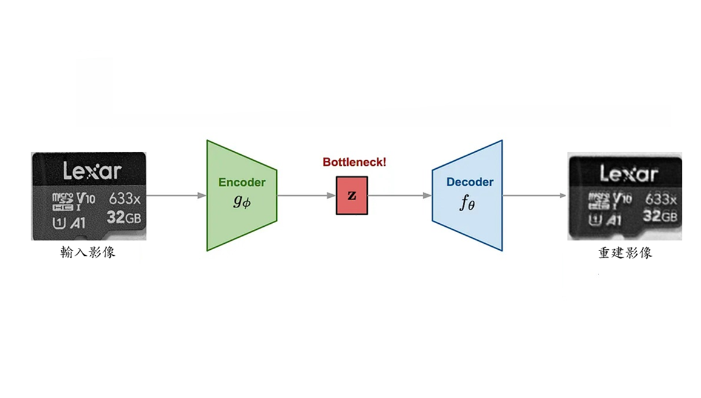
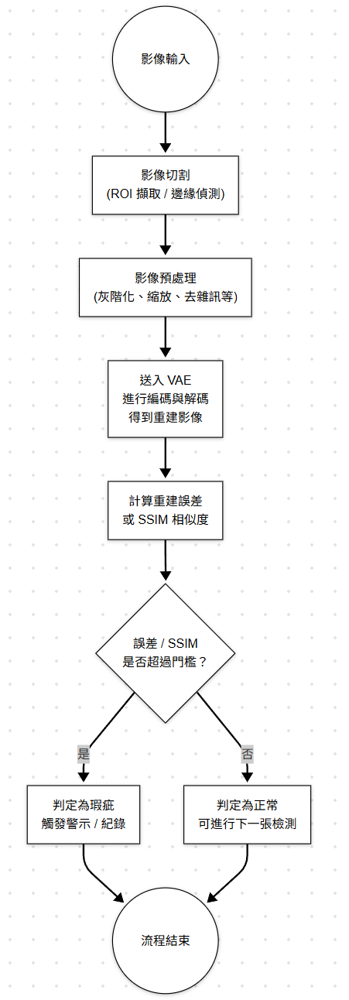
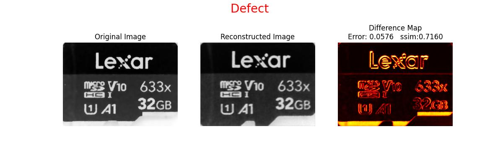
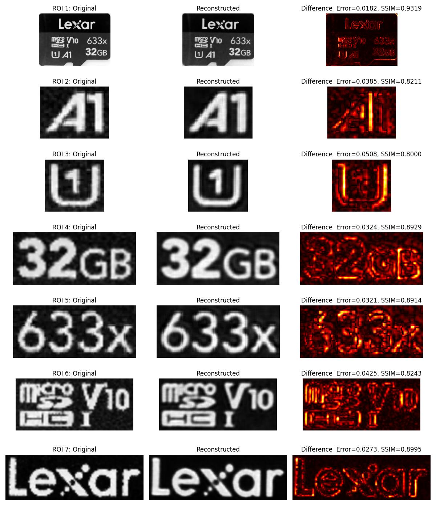

# iSD Viewer：以 VAE 進行 SD 卡印刷瑕疵檢測

**iSD Viewer: VAE-Based Printing Defect Detection for SD Cards**

以變分自編碼器（Variational Autoencoder, VAE）重建 SD 卡表面影像，再用結構相似度（SSIM）與重建誤差比較原圖與重建圖，判斷 SD 卡印刷是否有瑕疵。本專案為國立高雄科技大學電子工程系的大學專題。

[English summary](#english-summary)

---

## 專案背景

SD 卡產線的印刷外觀多仰賴人工目檢，容易因視覺疲勞造成漏檢與重工。本專題嘗試以 AI 視覺檢測輔助判斷以下印刷瑕疵：

- 顏色異常
- 刮痕
- 印刷偏移
- 印刷缺漏（空白）

## 方法

<p align="center">
  
</p>

VAE 只用**無瑕疵**的影像訓練，因此它學會的是「正常 SD 卡長什麼樣子」。遇到有瑕疵的卡片時，重建結果會偏向正常外觀，原圖與重建圖之間的差異就會變大。

<p align="center">
  
</p>

1. **影像擷取**：在封閉環境搭配 LED 光源拍攝，減少外部光線干擾。
2. **影像切割**：擷取 ROI、邊緣偵測，取出單張 SD 卡表面。
3. **前處理**：OpenCV 縮放為 350 × 256、灰階化、高斯模糊（`GaussianBlur`）加雙邊濾波（`bilateralFilter`）、正規化。多區域版本的訓練程式另外加上中值濾波（`medianBlur`）。
4. **VAE 重建**：Encoder / Decoder，潛在維度 160。
5. **兩階段比對**：
   - 第一階段（全域）：計算整張影像與重建圖的 SSIM 與重建誤差。
   - 第二階段（局部）：當全域數值落在邊界附近時，從差異圖找出可疑區塊（ROI），針對每個區塊再算一次 SSIM。
6. **判定**：以 SSIM 門檻 0.83 為主。多區域版本的最終規則是 SSIM ≥ 0.83 且重建誤差 ≤ 0.02 才判定為正常，其餘判定為瑕疵。各版本的第一階段門檻略有不同，以程式內的數值為準。

## 結果範例

**瑕疵樣本**：差異圖（右）在印刷異常處明顯偏亮。



**無瑕疵樣本**：進一步切出各個印刷區域（ROI）逐一比對。

<p align="center">
  
</p>

### 報告中的實驗結果

> **VAE 只用無瑕疵影像訓練。** 下面「有瑕疵」的樣本不參與 VAE 訓練，只用來觀察 SSIM 分佈、決定判定門檻，以及最後的測試。

**期末成果報告（2025 年 11 月，對應本 repo 目前的程式）**

- 共使用 480 張樣本（含門檻校準與測試）。
- 獨立測試集：無瑕疵 120 張、有瑕疵 120 張，瑕疵類型包含異色、刮痕、歪斜、留白。
- 依 SSIM 分佈訂出門檻 **0.83**，測試集上 Recall 與真陰率（TN rate）皆為 **100%**。
- 最終成果為一次可辨識 12 片 SD 卡的檢測模組（多區域版本）。

**ITAOI 2025 研討會論文（2025 年 4 月，較早的版本）**

| 分組 | 無瑕疵 | 有瑕疵 | 合計 |
|---|---:|---:|---:|
| 門檻校準 | 100 | 100 | 200 |
| 測試 | 50 | 50 | 100 |
| **合計** | **150** | **150** | **300** |

- 共模擬 12 種瑕疵類型，100 張測試影像皆判定正確。
- 範例：瑕疵影像 SSIM = `0.5251`，無瑕疵影像 SSIM = `0.9182`。

> 以上為專題報告在各自測試集上的結果，不代表在其他產線、卡片型號或光源條件下也能達到相同表現。

`results/ssim_logs/` 保留了單片版本最後一次批次執行的原始輸出（每行：檔名、SSIM、重建誤差），可作為參考。

## 專案結構

```text
src/
  single_card/              # 單片：訓練、資料夾批次檢測、相機即時檢測
  multi_region/             # 多區域（D1–D4 四個區域各一個模型）
  multi_region_camera_v2/   # 多區域的後期版本（加入局部 ROI 比對）
data/samples/               # 少量範例影像（非完整資料集）
results/examples/           # 檢測結果圖
results/ssim_logs/          # 批次檢測的 SSIM / 誤差記錄
weights/                    # 權重說明（權重檔放在 GitHub Releases）
docs/                       # 圖片與專案整理紀錄
```

每個資料夾都有三支程式：

| 程式 | 用途 |
|---|---|
| `training_model*.py` | 用無瑕疵影像訓練 VAE，輸出 `.weights.h5` |
| `vae_folder*.py` | 讀取資料夾中的測試影像批次檢測，輸出結果圖與 `ssim_log.txt` |
| `Camera + VAE*.py` | 接上相機即時拍攝並檢測 |

## 環境安裝

原始開發環境的套件版本沒有留下紀錄，`requirements.txt` 是依程式的 import 整理而成，沒有鎖定版本。

```bash
python -m venv .venv
.venv\Scripts\activate
pip install -r requirements.txt
```

相機程式使用 Windows 的 DirectShow（`cv2.CAP_DSHOW`），相機編號可能需要依電腦調整。

## 下載權重

權重檔每個約 662 MB，放在本專案的 [Releases](https://github.com/zxc890806zxc-sudo/vae-sd-card-defect-detection/releases) 頁面。下載後放到要執行的程式**同一個資料夾**（程式用相對路徑讀取）：

| 檔案 | 給哪個版本用 |
|---|---|
| `vae_model.weights.h5` | `src/single_card/` |
| `vae_D1.weights.h5` ~ `vae_D4.weights.h5` | `src/multi_region/`、`src/multi_region_camera_v2/` |

檔案校驗碼（SHA-256）請見 [`weights/README.md`](weights/README.md)。

## 執行方式

程式用**目前所在的資料夾**當基準，讀取這些相對路徑：

| 路徑 | 內容 |
|---|---|
| `model-image/` | 訓練用的無瑕疵影像（多區域版本：`model-image/D1` ~ `D4`） |
| `test-image/defect/`、`test-image/defect-free/` | 測試影像（多區域版本：底下再分 `D1` ~ `D4`） |
| `*.weights.h5` | 權重檔 |
| `result/` | 程式自動建立，輸出結果圖與 `ssim_log.txt` |

`data/samples/` 已經按照這個結構放好範例圖，切換到那個資料夾就能直接執行（Windows）：

**單片版本**

```powershell
cd data\samples\single_card
# 先把 Releases 下載的 vae_model.weights.h5 放到這個資料夾
python ..\..\..\src\single_card\vae_folder.py      # 批次檢測，結果輸出到 result\
python ..\..\..\src\single_card\training_model.py  # （選用）用範例圖重新訓練，會覆蓋權重檔
```

**多區域版本**

```powershell
cd data\samples\multi_region
# 先把 vae_D1 ~ vae_D4.weights.h5 放到這個資料夾
python ..\..\..\src\multi_region\vae_folder_12.py
```

範例圖每類只有 3～4 張，只夠確認程式能跑；要重新訓練出可用的模型，需要準備完整的資料集。

## 限制

- 完整資料集未公開，`data/samples/` 只有少量範例。
- 程式保留專題當時的原貌，三個版本之間有重複的程式碼與寫死的相對路徑。
- 未記錄 TensorFlow、CUDA 版本，在新環境執行可能需要調整。

## 專案資訊

- **學校**：國立高雄科技大學 電子工程系
- **發表**：ITAOI 2025 離島資訊技術與應用研討會
- **類型**：大學專題／電腦視覺

---

## English summary

An undergraduate project at National Kaohsiung University of Science and Technology (NKUST) for detecting printing defects on SD cards.

- A **Variational Autoencoder** (latent dim 160, input 350 × 256 grayscale) is trained only on defect-free card images.
- At inspection time, the input image is reconstructed and compared with the original using **SSIM** and reconstruction error. Multi-region variants additionally compare local regions (ROIs) found in the difference map.
- Defective images are never used to train the VAE; they are only used to choose the SSIM threshold (0.83) and for testing.
- In the final project report, an independent test set of 120 defect-free and 120 defective images reached 100% recall and 100% true-negative rate. This is a result on that specific dataset, not a guarantee of production performance.
- `data/samples/` follows the folder layout the scripts expect, so you can `cd` into it and run a script directly (see "執行方式").
- Three script variants are included: `single_card`, `multi_region` (one model per region D1–D4), and `multi_region_camera_v2`.
- Model weights (~662 MB each) are available on the [Releases](https://github.com/zxc890806zxc-sudo/vae-sd-card-defect-detection/releases) page. Place them in the same folder as the script you run.
- Presented at ITAOI 2025 (Offshore Island Information Technology and Application Symposium).
